

  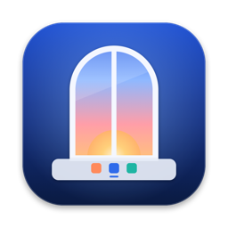

<h1 align="center">Fenestra</h1>

  <b>The Windows 11 desktop, on your Mac.</b> 
  Taskbar, Start menu, Quick Settings, Snap Layouts, Alt+Tab, Task view and clipboard history. 
  Native, free, and fully reversible.

  

  
  
  
  
  

  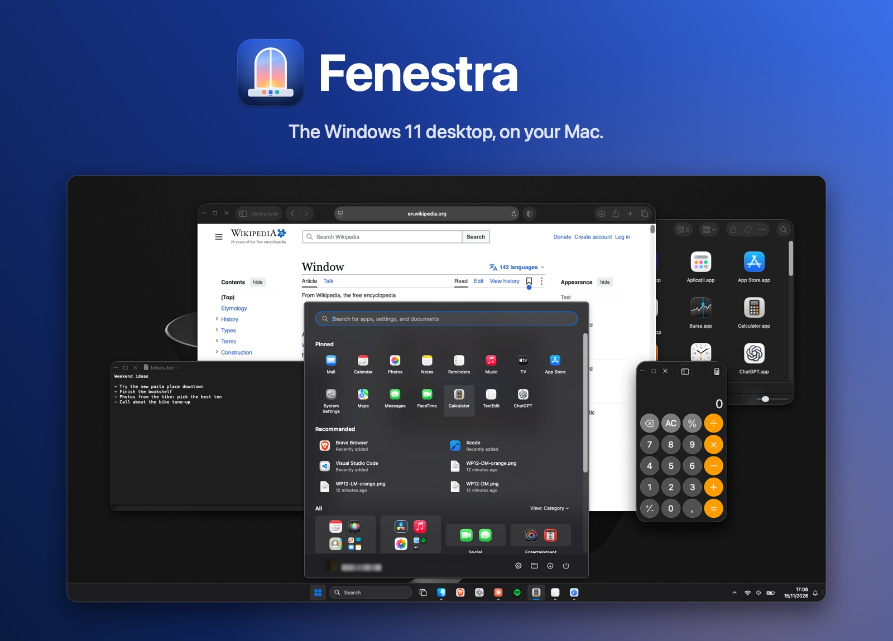

Switched from Windows and miss the taskbar? Use a PC at work and a Mac at home? Fenestra replaces the Dock and menu
bar with the Windows 11 desktop you already know: same buttons, same shortcuts, same muscle memory. It's a native
Mac app, it idles at 0% CPU, and quitting it puts your Mac back exactly how it was.

## Features

### Taskbar and Start

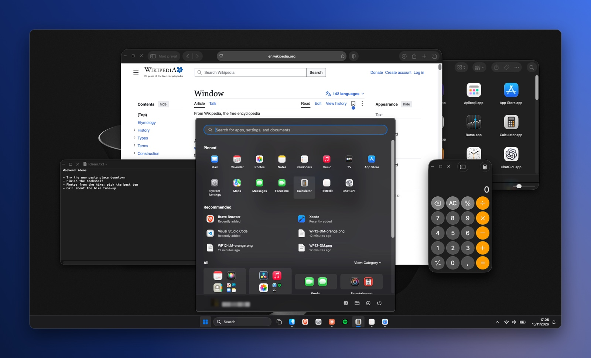

- **Start menu** with pinned apps, recent files, and All apps by category, list or grid. Type to search apps,
  files and settings. Tap **Command** alone to open it, like the Windows key.
- **Taskbar** with your pinned and open apps, centered or left aligned, with the running-app line under each icon.
- Click to switch, click again to minimize. Drag to reorder, middle-click for a new window, unread badges included.
- The far right corner shows the desktop. Auto-hide is available, and the taskbar steps aside for full-screen video.

  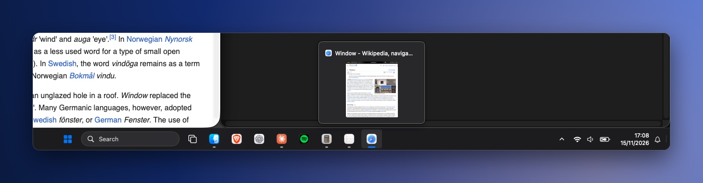
  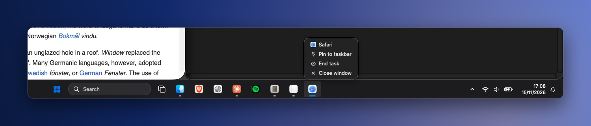

Hover an app for live previews of its windows. Right-click it for the jump list: recent files, new window, pin,
Close window and End task.

### Quick Settings and the calendar

  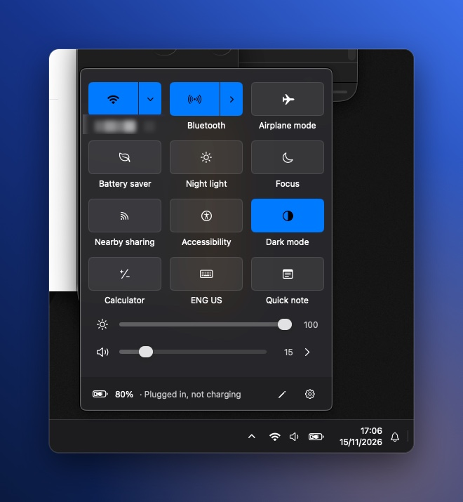
  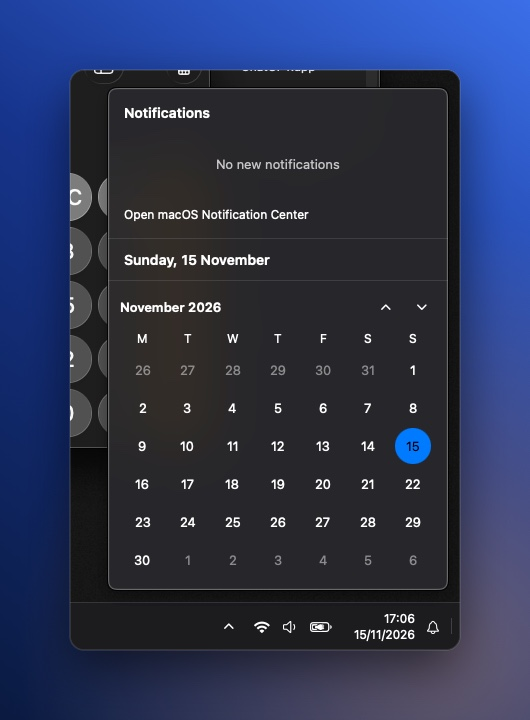

- **Quick Settings:** Wi-Fi and Bluetooth lists to connect devices, volume and brightness sliders (external
  monitors too), and tiles for Airplane mode, Battery saver, Night light, Focus, Nearby sharing (AirDrop), Cast,
  Accessibility, Keyboard layout and Live captions.
- Edit the tiles like on Windows: reorder, remove, or add Mac extras such as Dark mode, screenshots, Quick Note and
  Calculator.
- Live tooltips on the tray icons, scroll over the speaker to change the volume, and a charging badge on the battery.
- The clock opens the calendar and your notifications. The **^** arrow holds the Mac's menu bar icons.

### Snap Layouts and Snap Assist

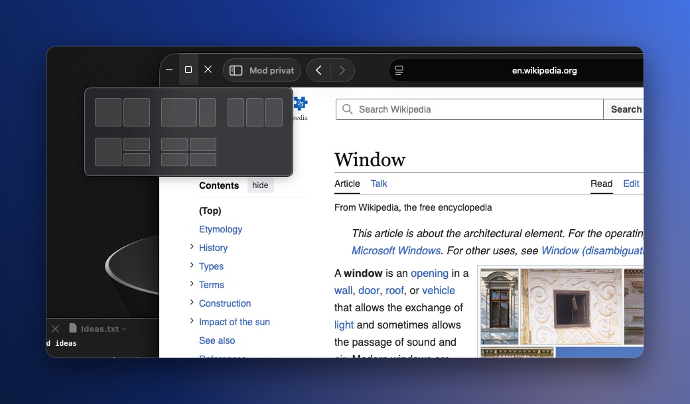

- Every window gets Windows-style **minimize, maximize and close** buttons, plus a menu button with the app's menus
  (File, Edit...), since the menu bar is hidden.
- Hover maximize for **Snap Layouts** (halves, thirds, quarters), or drag a window to an edge or corner to snap it.
- **Quick snap** (a Mac extra): fling a window toward an edge and let go early, and it still lands there.

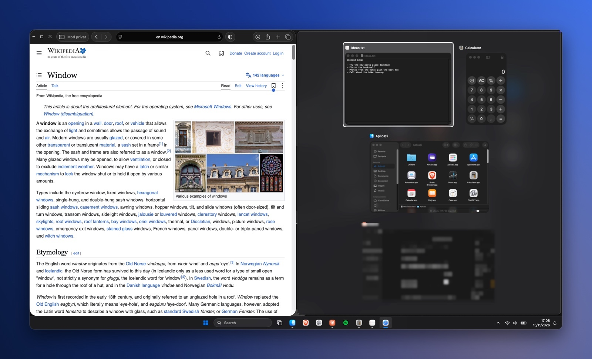

**Snap Assist** fills the rest of the screen with your other windows. Snapped windows form a group that comes back
together from the taskbar.

### Alt+Tab and Task view

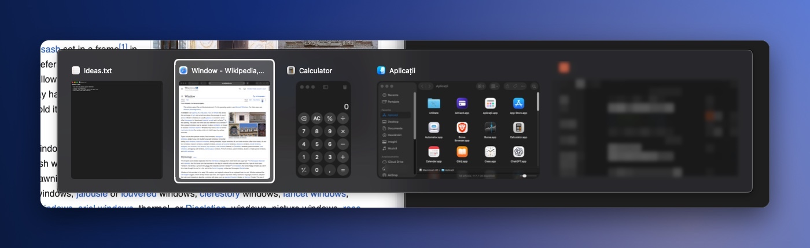

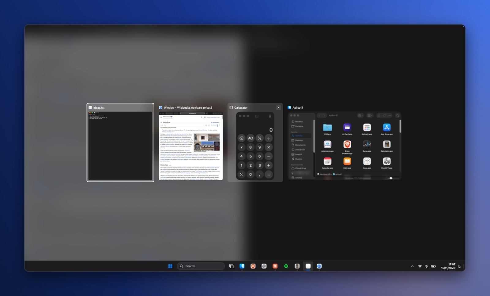

**Option+Tab** switches windows with live previews, and **Task view** shows everything at a glance.

### Clipboard history

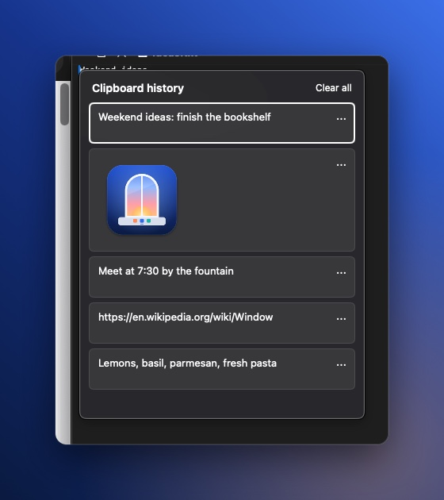

**Control+Option+V** shows the last things you copied: text, links, images and files. Paste any of them, pin
favorites, or delete them. Passwords copied from password managers are never saved.

### Multiple displays

A taskbar on every display, each with its own clock and show-desktop corner. Unplug a monitor and its windows
minimize; plug it back in and they return to where they were.

 

## Keyboard shortcuts

| On Windows | On a Mac with Fenestra | Does |
|---|---|---|
| Windows key | tap **Command** | Start |
| Windows + arrows | **Control+Option+arrows** | Snap windows |
| Windows + Z | **Control+Option+Z** | Snap layouts |
| Windows + Tab | **Control+Option+Tab** | Task view |
| Windows + D | **Control+Option+D** | Show desktop |
| Windows + V | **Control+Option+V** | Clipboard history |
| Alt+Tab | **Option+Tab** | Switch windows |
| Alt | tap **Option** | App menus |
| Alt+Space | **Option+Space** | Window menu |

## Install

1. **[Download Fenestra.dmg](https://github.com/PRMotorWorks/Fenestra/releases/latest/download/Fenestra.dmg)**,
   open it, and drag **Fenestra** onto **Applications**.
2. Open Fenestra from Applications. macOS says it can't verify the app (Fenestra isn't notarized by Apple yet):
   click **Done**, then go to **System Settings > Privacy & Security**, scroll down and click **Open Anyway**.
   You only do this once.
3. After a few seconds the taskbar appears, and the Dock and menu bar hide.
4. Turn on **Accessibility** (required) and **Screen & System Audio Recording** (for window previews) in the
   window Fenestra shows.

Right-click an empty part of the taskbar for **Taskbar settings**. Almost everything can be switched off there.
The full guide, with updating and troubleshooting, is in [INSTALL.md](INSTALL.md).

## FAQ

<b>Does it change my Mac permanently?</b>

No. Fenestra hides the Dock and menu bar while it runs and records every setting it changes. Quitting puts them
back, and **Taskbar settings > Fenestra > Uninstall…** removes the app and everything it created. If it ever
crashes, your Dock and menu bar come back immediately. Even dragging it to the Trash is handled: your settings are
restored at the next login.

<b>Why does macOS warn me the first time?</b>

Apple only skips that warning for apps signed with a paid Apple Developer ID and notarized. Fenestra is signed but
not notarized yet. The code is all here: you can read it, or build it yourself with Xcode (see
[DEVELOPMENT.md](DEVELOPMENT.md)).

<b>Does it collect data or need the internet?</b>

No. Fenestra has no network code at all: no analytics, no accounts, no update pings. Screen Recording is used only
for live window thumbnails; nothing is recorded or saved. Location access, if you grant it, is only because macOS
hides Wi-Fi network names without it.

<b>Will it slow my Mac down?</b>

It idles at 0% CPU and uses about 40 MB of memory. It's a single native AppKit and SwiftUI app, not a web wrapper.

<b>Which Macs does it run on?</b>

Any Mac running macOS Tahoe (26) or later, Apple silicon or Intel.

<b>Can I keep some Mac things, like the menu bar?</b>

Yes. Every change Fenestra makes to macOS has its own switch in **Taskbar settings > Fenestra > macOS changes**, and
most features can be turned off one by one.

## Uninstall

Taskbar settings > **Fenestra** tab > **Uninstall…**. Your Dock, menu bar and Mac settings go back to how they were.

## Building from source

Fenestra builds with Xcode and has no dependencies. See [DEVELOPMENT.md](DEVELOPMENT.md) for the architecture,
every system change it makes, and test checklists. Bug reports and pull requests are welcome.

## License

[MIT](LICENSE). Fenestra is an independent project and is not affiliated with, endorsed by, or sponsored by
Microsoft. Windows is a trademark of Microsoft Corporation, used here only to describe what Fenestra does.
